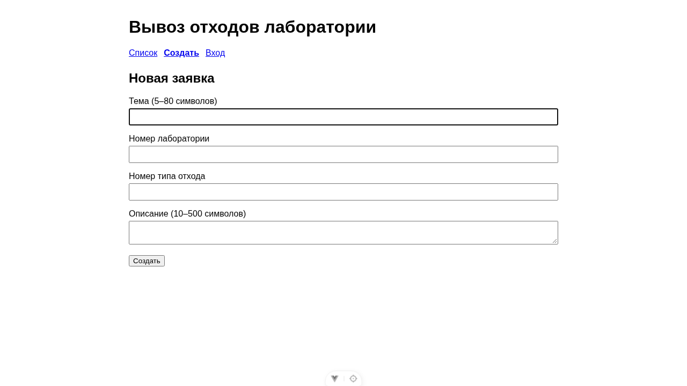
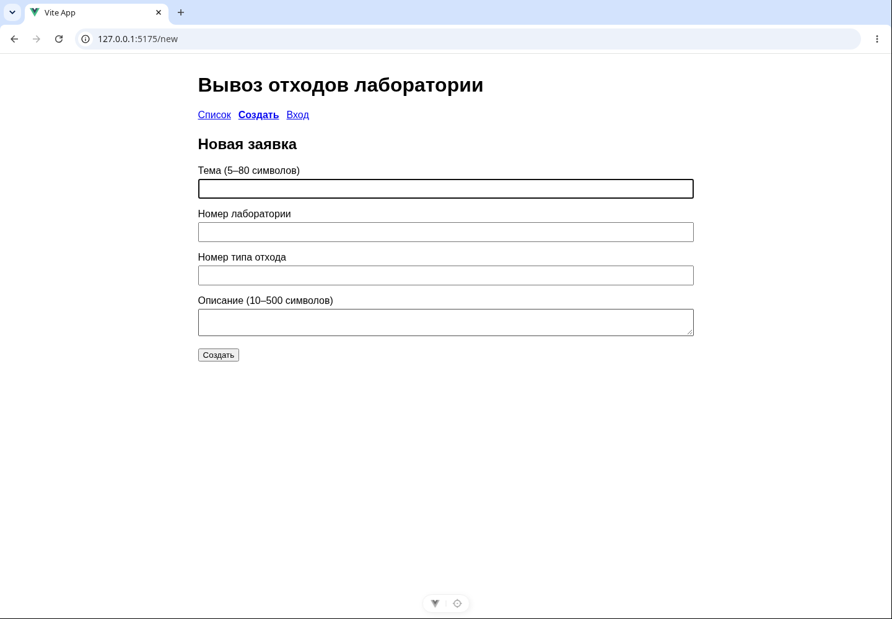

# Лабораторная работа 4. Компоненты и маршруты

Студент: Салават Исмагилов · Группа: ТРИС-2-23

Тема: Вывоз отходов лаборатории.

## Что сделано

Подключён `vue-router`. Вместо переключения экранов кнопками используются ссылки и три маршрута:

| Путь | Страница |
|------|----------|
| `/` | Список заявок |
| `/new` | Создание заявки |
| `/login` | Вход |

## Структура

```text
src/
├── App.vue
├── main.js
├── router.js
├── wasteRequestsStore.js
├── components/
│   ├── AppHeader.vue
│   └── WasteRequestTable.vue
└── pages/
    ├── WasteRequestList.vue
    ├── WasteRequestNew.vue
    └── Login.vue
```

```text
App.vue
├── AppHeader (общее меню)
└── router-view
    └── список / форма / вход
```

Таблица получает массив через обязательный prop `items`. Источник массива — `wasteRequestsStore.js`. Таблица не создаёт копию данных и не изменяет их. Шапка находится снаружи `router-view`, поэтому остаётся на всех страницах.

## Проверка

- [x] Три адреса открыты напрямую в браузере и после перезагрузки.
- [x] На каждом экране есть общее меню из трёх ссылок.
- [x] Нет ошибок JavaScript в браузере.
- [x] `npm run build` завершился успешно.





Дополнительно снято окно Chromium с адресной строкой `/new`. Снимки получены автоматически; для проверки использован отдельный экземпляр Vite на порту 5175.

## Ответы на вопросы

`/new` — адрес страницы Vue, а `POST /api/waste-requests` — будущий запрос создания к серверу. Сам переход на страницу ничего не создаёт.

Общим массивом владеет модуль состояния. Props передают этот массив таблице. Если положить массив только в страницу списка, при повторном создании страницы состояние может потеряться.
