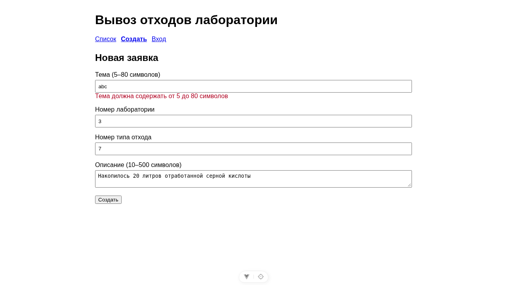
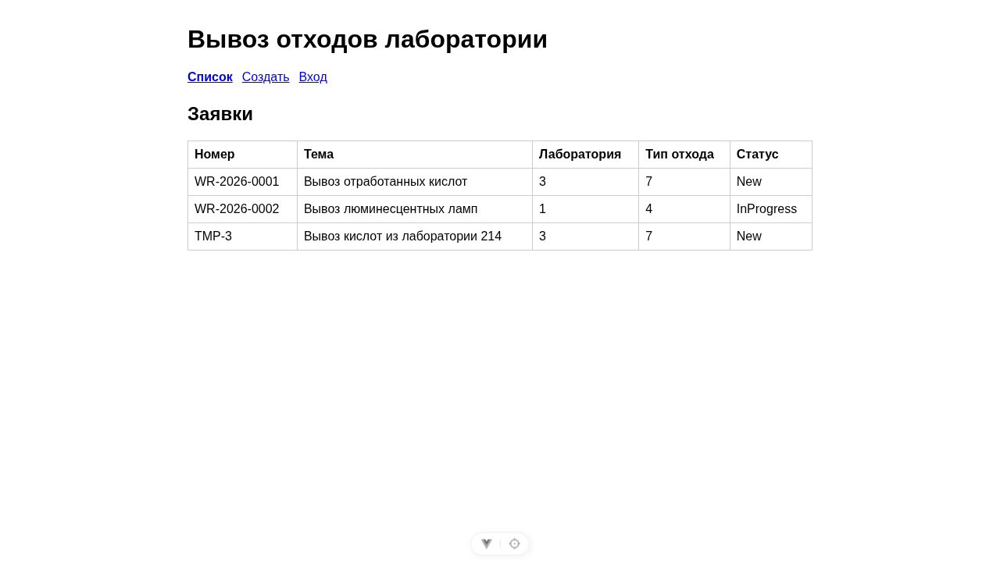
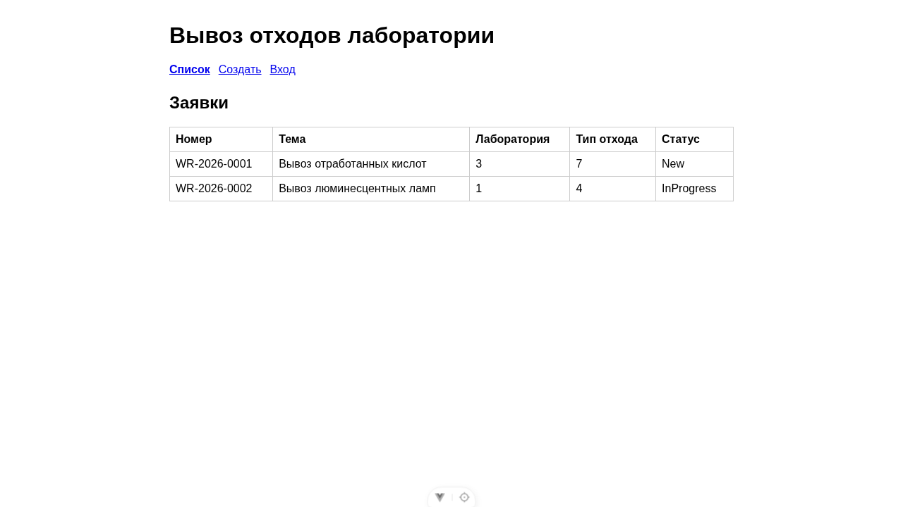

# Лабораторная работа 5. Форма и список в памяти

Студент: Салават Исмагилов · Группа: ТРИС-2-23

Тема: Вывоз отходов лаборатории.

## Что сделано

Форма связана с состоянием через `v-model`. Для `laboratoryId` и `wasteTypeId` используется `.number`. Обработчик `@submit.prevent` не даёт браузеру перезагрузить страницу при Enter.

Общий модуль `wasteRequestsStore.js` содержит `items`, счётчик и `addItem`. Новая заявка получает учебный номер `TMP-3`, `TMP-4` и статус `New`. После добавления форма очищается, открывается список.

## Правила

| Поле | Проверка |
|------|----------|
| `title` | 5–80 символов после `trim()` |
| `description` | 10–500 символов после `trim()` |
| `laboratoryId` | целое число больше нуля |
| `wasteTypeId` | целое число больше нуля |

Ошибки показаны рядом с полями. До исправления данных `addItem` не вызывается. Текст выводится интерполяцией Vue, без `v-html`.

## Проверка в браузере

| Случай | Действие | Результат |
|--------|----------|-----------|
| Успех | Тема «Вывоз кислот из лаборатории 214», лаборатория 3, тип 7, описание ≥ 10 символов; Enter | Открыт `/`, появилась одна строка `TMP-3`, статус `New` |
| Отказ | Тема `abc` | Под полем ошибка, массив остался из двух исходных заявок |
| Память | Обновление страницы после создания | Новая строка исчезла; остались две исходные |
| Типы | Проверка созданного объекта | Оба внешних ключа — числа |
| Очистка | Повторный переход на `/new` | Поля пусты |

После F5 новые записи пропали ожидаемо: сервера и БД пока нет. `npm run build` прошёл. Проверки выполнены в браузере автоматически.

## Script и template

| Задача | Script | Template |
|--------|--------|----------|
| Поля | `form.value.title` | `v-model="form.title"` |
| Проверка | `validateWasteRequest(form.value)` | `errors.title` под полем |
| Отправка | `onCreate()` | `@submit.prevent="onCreate"` |
| Возврат | `router.push('/')` | Отрисовывается страница списка |

В ЛР6 форма будет вызывать API-модуль. Учебный счётчик перейдёт в mock, а номер будет приходить в ответе.
