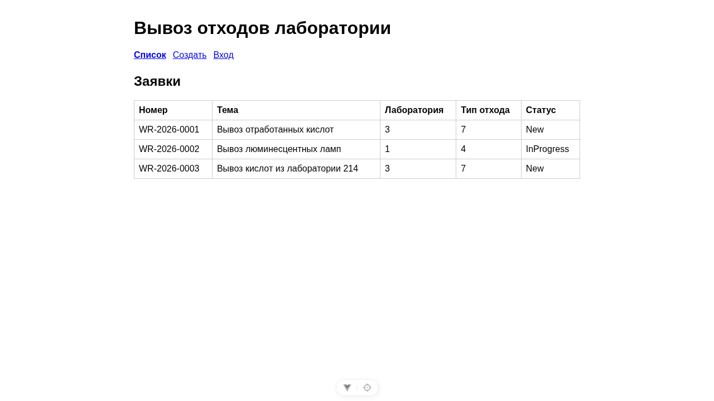
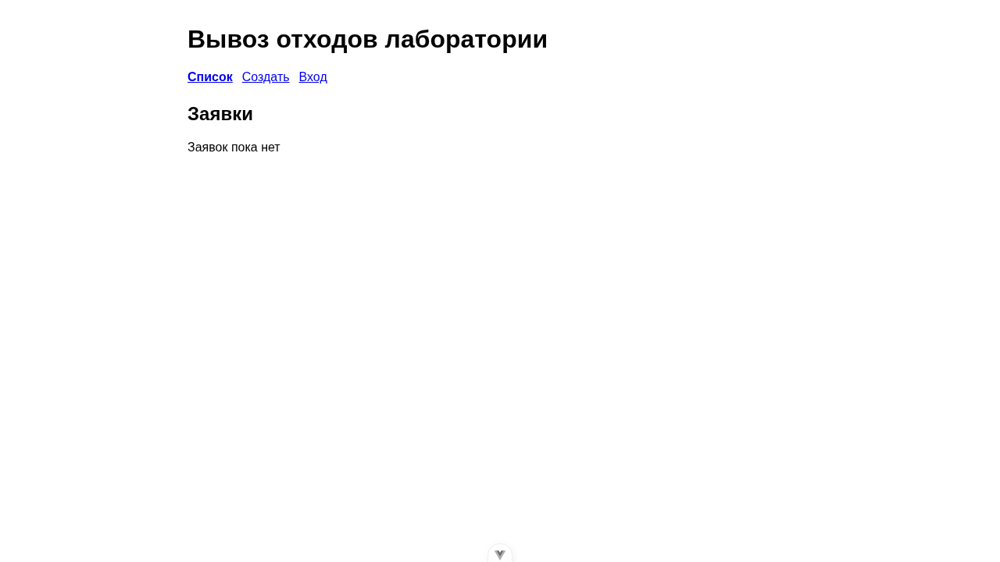
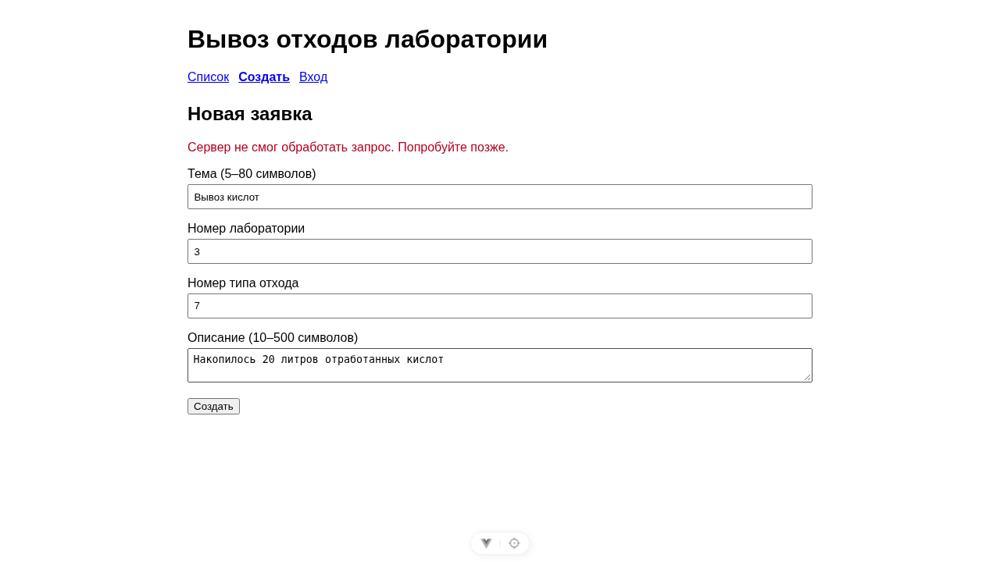
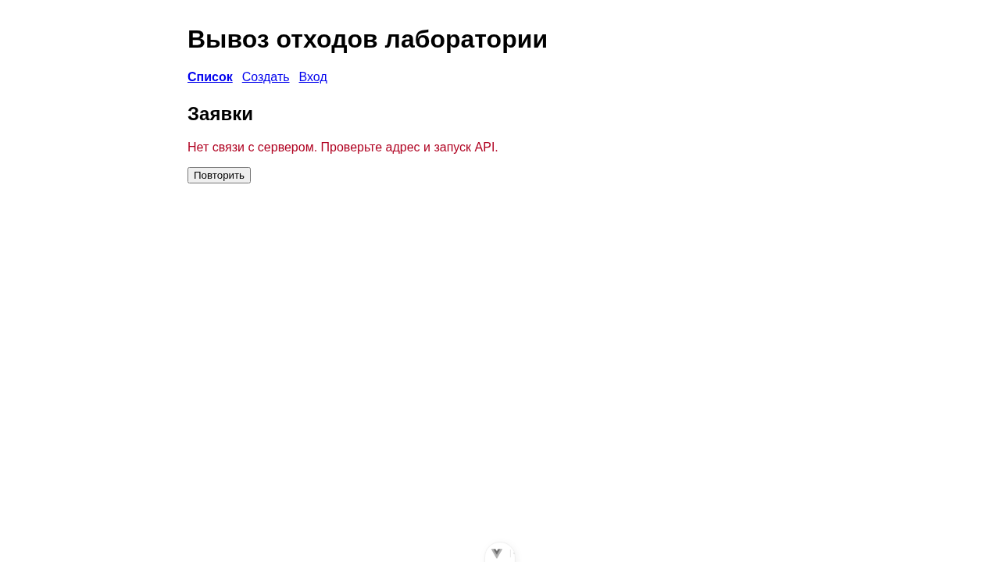

# Лабораторная работа 6. Клиент API и mock

Студент: Салават Исмагилов · Группа: ТРИС-2-23

Тема: Вывоз отходов лаборатории.

## Что сделано

В `src/api/wasteRequests.js` находятся `getWasteRequests()` и `createWasteRequest(body)`. Страницы вызывают эти функции, не обращаются к mock напрямую и не знают адрес API. Адрес берётся из `VITE_API_BASE_URL`, переключение — из `VITE_USE_MOCK`.

```dotenv
VITE_API_BASE_URL=http://localhost:5000
VITE_USE_MOCK=true
```

В Git хранится `.env.example`, локальный `.env` исключён. После изменения переменных нужно перезапустить Vite.

Mock находится в `src/api/mockWasteRequests.js`. Он ждёт 500 мс, возвращает `ok`, `status`, `data`. Проверяет поля, назначает `id`, `number`, `New` и даты. Форма получает созданный объект из ответа; учебный счётчик ЛР5 в форме больше не используется.

`wasteRequestsStore.js` хранит общий список интерфейса, а mock — отдельные учебные серверные данные. После F5 оба модуля создаются заново. Это ещё не PostgreSQL.

## Состояния списка

| Состояние | На экране |
|-----------|-----------|
| `loading` | Загрузка… |
| `empty` | Заявок пока нет |
| `data` | Таблица |
| `error` | Сообщение и кнопка «Повторить» |

Состояния взаимоисключающие. Во время создания кнопка заблокирована, а повторный submit сразу завершается. В `finally` блокировка снимается. При отказе заполненные поля остаются.






## Проверка трёх отказов

| Отказ | Как проверено | Ветка | Сообщение |
|-------|---------------|-------|-----------|
| 400 | Прямой вызов `createWasteRequest` с темой `abc`, обходя клиентскую проверку | `!response.ok`, `status === 400` | Проверьте поля формы. |
| 500 | `mockSettings.force500 = true`, отправка валидной формы | `!response.ok`, `status >= 500` | Сервер не смог обработать запрос. Попробуйте позже. |
| Нет связи | `VITE_USE_MOCK=false`, адрес незапущенного API `http://127.0.0.1:59999` | Отказ `fetch`, сетевой `catch` | Нет связи с сервером. Проверьте адрес и запуск API. |

Короткая тема в обычной форме отклоняется ещё на клиенте, поэтому для проверки именно ответа 400 API вызывается отдельно. `fetch` не считает HTTP 400/500 отсутствием связи: статус проверяется после получения ответа. Дополнительно обе HTTP-ветки настоящего `fetch` проверены перехватом ответов в браузерном тесте; это тестовые ответы, не работа backend.





## Воспроизведение mock и доказательства

В консоли браузера на странице приложения:

```js
const { mockSettings } = await import('/src/api/mockWasteRequests.js')
mockSettings.force500 = true
// Перейти на создание и отправить валидную форму: будет 500.
// Для пустого списка:
mockSettings.force500 = false
mockSettings.empty = true
// Перейти на список или нажать «Повторить».
```

Проверка 400 независимо от клиентской формы:

```js
const api = await import('/src/api/wasteRequests.js')
await api.createWasteRequest({
  title: 'abc', laboratoryId: 3, wasteTypeId: 7,
  description: 'Накопилось 20 литров отработанной кислоты'
})
```

Mock без HTTP: запросов к порту 5000 в Network нет. Реальные вызовы mock выводятся в Console с подписью `[mock без HTTP]`, методом и статусом. [Результаты автоматической проверки](lab-06-checks.json) содержат полученные ошибки и журнал вызовов. Снимки выше показывают реальные состояния интерфейса.

Для сдачи по методичке нужно открыть F12 → Network и объяснить, что запрос к `VITE_API_BASE_URL + '/api/waste-requests'` появится при отключении mock. Замену скрина Network выводом Console для прямого mock нужно согласовать с преподавателем; это согласование здесь не отмечено как выполненное. Скрин Console успеха 201 и отказа 400 следует сделать в обычном браузере на защите.

## Итог проверки

- [x] Четыре состояния списка проверены в браузере.
- [x] Два submit подряд создали одну строку `WR-2026-0003`.
- [x] Проверены 400, 500 и реальный отказ соединения.
- [x] После 500 кнопка доступна, поля сохранены.
- [x] F5 очищает добавленные записи mock.
- [x] `npm test`: 4 теста правил и mock.
- [x] `npm run build` проходит.
- [ ] Скрин Network или согласованная преподавателем замена Console.

Связь с критерием 1 ЛР1: заведующий заполняет данные вывоза, успешный ответ добавляет заявку с `New` в список. Пока результат имитирует mock; постоянное хранение и настоящее серверное создание относятся к следующим работам.
