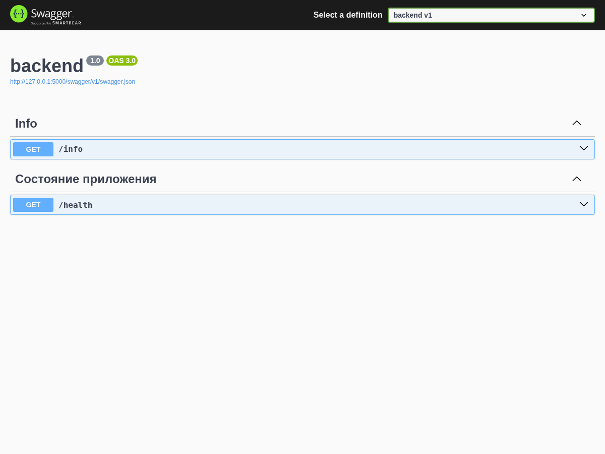

# Лабораторная работа 7. Каркас Web API

Студент: Салават Исмагилов · Группа: ТРИС-2-23

Тема: Вывоз отходов лаборатории.

## Что сделано

В корне репозитория рядом с `frontend` создан `backend` — ASP.NET Core Web API на .NET 8. HTTP-порт — 5000, как на схеме ЛР2.

```text
backend/
├── backend.csproj
├── global.json
├── packages.lock.json
├── Program.cs
├── appsettings.json
├── appsettings.Development.json
├── Properties/launchSettings.json
├── Controllers/InfoController.cs
├── Services/
│   ├── IApplicationInfoService.cs
│   └── ApplicationInfoService.cs
├── Models/ApplicationInfo.cs
└── Data/README.md
```

`Controllers` принимает HTTP-запросы, `Services` содержит логику приложения, `Models` — модели ответов. В `Data` позднее появится работа с PostgreSQL. `bin` и `obj` исключены из Git.

## Адреса

| Адрес | Результат |
|-------|-----------|
| `/health` | `200`, текст `ok` |
| `/info` | `200`, имя системы, `Development`, версия `ЛР7` |
| `/swagger/index.html` | Интерактивный Swagger в Development |
| `/swagger/v1/swagger.json` | Описание двух служебных адресов |

`/health` реализован коротким служебным endpoint. `/info` реализован контроллером: получает `IApplicationInfoService` через конструктор и возвращает результат сервиса.

Сервис зарегистрирован через DI в `Program.cs`, чтобы контроллер не создавал реализацию через `new`. Используется `AddSingleton<IApplicationInfoService, ApplicationInfoService>()`.

## Запуск и проверка

Из корня репозитория:

```bash
cd backend
dotnet restore --locked-mode
dotnet run
```

Проверено SDK 8.0.426:

- [x] Восстановление пакетов с lock-файлом прошло.
- [x] `dotnet build --no-restore`: 0 ошибок и 0 предупреждений.
- [x] Сервер слушает `http://localhost:5000`.
- [x] `/health` возвращает `200`, `ok`.
- [x] `/info` возвращает имя системы и `Development`.
- [x] Swagger открывается и отображает `/health` и `/info` в браузере.
- [x] Сервер остановлен, команды запуска повторены; `/health` и `/info` снова отвечают.
- [ ] Другой студент самостоятельно повторил запуск: это нужно проверить при сдаче.




## Чеклист: health ≠ создание заявки

| Утверждение | Да/нет |
|-------------|--------|
| `/health` возвращает 200 без тела заявки | да |
| `/health` не принимает `title`, `laboratoryId`, `wasteTypeId`, `description` | да |
| Успешный `/health` не доказывает работу POST | да |
| Создание главного объекта относится к ЛР8 | да |
| README объясняет различие | да |
| Swagger и `/health` проверены отдельно | да |

Данные заявок пока в памяти, после перезапуска пропадут. В текущей работе заявки живут только в mock на клиенте. Сам backend ЛР7 ещё не реализует создание и хранение заявок. Поэтому его перезапуск не является проверкой сохранности заявок.

## Ответы на вопросы

C# — язык исходного кода. .NET — платформа и SDK. ASP.NET Core — web-фреймворк, который обрабатывает HTTP-запросы.

DI позволяет заменить реализацию сервиса, не меняя контроллер. Контроллер принимает запрос, сервис выполняет свою задачу, затем контроллер формирует HTTP-ответ.

Успешный `/health` доказывает только, что процесс отвечает на служебный запрос. Он ничего не говорит о валидации или сохранении заявки. Полный CRUD, CORS и соединение Vue с backend здесь не добавлялись, как требует методичка ЛР7.
