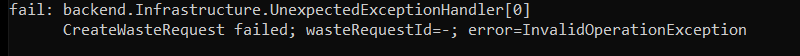
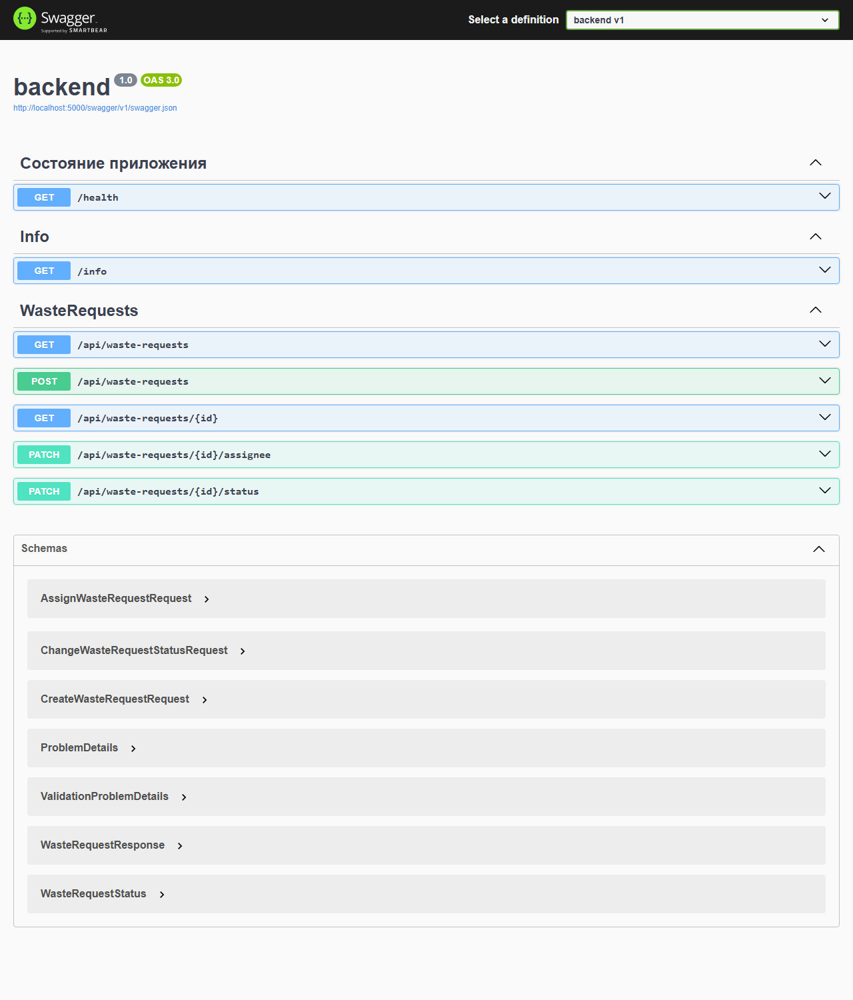

# Лабораторная работа 8. REST: заявки и проверка полей

Студент: Салават Исмагилов · Группа: ТРИС-2-23

Тема: Вывоз отходов лаборатории.

## Что сделано

В backend из ЛР7 добавлены адреса для заявок на вывоз отходов. Пути и поля взяты из контракта API ЛР2. Данные пока хранятся в памяти: после перезапуска сервера список пустой, так и должно быть до подключения PostgreSQL.

```text
backend/
├── Controllers/WasteRequestsController.cs
├── Dtos/
│   ├── CreateWasteRequestRequest.cs
│   ├── AssignWasteRequestRequest.cs
│   ├── ChangeWasteRequestStatusRequest.cs
│   └── WasteRequestResponse.cs
├── Models/
│   ├── WasteRequest.cs
│   └── WasteRequestStatus.cs
├── Services/
│   ├── IWasteRequestService.cs
│   ├── WasteRequestService.cs
│   └── WasteRequestOperationResult.cs
└── Infrastructure/UnexpectedExceptionHandler.cs
```

Контроллер принимает запрос и возвращает код. Список в памяти, счётчик id и правила смены статуса находятся в `WasteRequestService`. Сервис возвращает `Success`, `NotFound` или `Conflict`, а контроллер превращает это в 200, 404 или 409.

## Адреса

| Метод и путь | Успех | Отказы |
|---|---:|---|
| `GET /api/waste-requests` | 200, массив или `[]` | — |
| `GET /api/waste-requests/{id}` | 200 | 404 |
| `POST /api/waste-requests` | 201, `id`, `number`, `status: "New"` | 400 |
| `PATCH /api/waste-requests/{id}/assignee` | 200 | 400, 404, 409 |
| `PATCH /api/waste-requests/{id}/status` | 200 | 400, 404, 409 |

DELETE нет, отмена делается статусом `Cancelled`. Ошибки отдаются стандартным `ProblemDetails`.

Пользователь до ЛР11 передаётся заголовком `X-User-Id` в POST и обоих PATCH. Без него будет 400. Чужой переход пока 409, а не 403.

## Проверка полей

| Поле | Проверка |
|------|----------|
| `title` | 5–80 символов |
| `description` | 10–500 символов |
| `laboratoryId`, `wasteTypeId` | целое число больше 0 |
| `status` | `New`, `InProgress`, `Closed`, `Cancelled`, другое значение — 400 |

Проверки стоят атрибутами на DTO. Контроллер с `[ApiController]`, поэтому плохое тело сразу получает 400 и до сервиса не доходит. В DTO создания нет `id`, `number` и `status`: если прислать `"status": "Closed"`, заявка всё равно создаётся со статусом `New`.

## Правила статусов (409)

| Переход | Условие |
|---------|---------|
| `New → InProgress` | исполнитель назначен и это он вызывает (`assigneeUserId == X-User-Id`) |
| `InProgress → Closed` | только назначенный исполнитель |
| `New → Cancelled` | пока без проверки роли, роль заведующего — в ЛР11 |
| остальные, например `New → Closed` | запрещены |

Назначить исполнителя можно только заявке в статусе `New`. Назначение статус не меняет.

## Лог при неожиданной ошибке

Ожидаемые 400 / 404 / 409 — обычные ответы. Неожиданное исключение ловит `UnexpectedExceptionHandler`: пишет в лог одну строку (операция, id заявки, тип ошибки) и отдаёт клиенту 500 без stack trace. Тело запроса в лог не попадает.

Для проверки сделан флаг `FailureSimulation:CreateWasteRequest`. Он работает только в Development и по умолчанию выключен. Исключение бросается в сервисе после проверки полей.

```powershell
cd backend
$env:FailureSimulation__CreateWasteRequest = "true"
dotnet run
```

Валидный POST вернул 500, в консоли появилась строка:



Ответ клиенту:

```json
{
  "type": "https://tools.ietf.org/html/rfc9110#section-15.6.1",
  "title": "Не удалось обработать запрос",
  "status": 500,
  "detail": "Внутренняя ошибка сервера. Повторите попытку позже.",
  "traceId": "00-4d22405644b8ded7ef32212892d1098d-042525a74e8d50fd-00"
}
```

Стандартный лог `ExceptionHandlerMiddleware` выключен в appsettings, чтобы ошибка не печаталась второй раз со всем стеком.

## Коллекция запросов

`docs/api-collection/waste-requests.postman_collection.json` — импорт в Postman через Import, базовый URL в переменной `baseUrl` (`http://localhost:5000`). Запускать по порядку на только что запущенном сервере: запрос 02 сохраняет id созданной заявки, остальные его используют. В каждом запросе есть проверка кода во вкладке Tests.

| № | Запрос | Ожидание |
|---|--------|----------|
| 01 | список | 200 |
| 02 | создание | 201, `New` |
| 03 | title `Абв` | 400 |
| 04 | `laboratoryId: "abc"` | 400 |
| 05 | заявка по id | 200 |
| 06 | id 999999 | 404 |
| 07 | `InProgress` без исполнителя | 409 |
| 08 | назначить исполнителя 9 | 200, статус `New` |
| 09 | `InProgress` от пользователя 4 | 409 |
| 10 | `InProgress` от исполнителя 9 | 200 |

Те же запросы есть в `backend/backend.http`.



## Проверка

- [x] `dotnet build`: 0 ошибок, 0 предупреждений. Новых пакетов нет.
- [x] Коллекция прошла целиком на свежем сервере.
- [x] Пустой список — 200 и `[]`.
- [x] `status: "Closed"` в POST игнорируется.
- [x] Нет `X-User-Id`, неизвестный статус, `laboratoryId: 0` — 400.
- [x] 404 для GET и обоих PATCH.
- [x] `New → InProgress → Closed` и `New → Cancelled` проходят.
- [x] Учебный сбой: клиент получил 500 без стека, в консоли одна строка.
- [x] После перезапуска сервера список пустой.
- [ ] Другой студент повторил коллекцию: проверить при сдаче.

## Ответы на вопросы

Назначение и статус разделены на два PATCH, потому что это разные действия разных людей. Исполнителя назначает заведующий, а статус меняет сам исполнитель. Если сделать один общий запрос, можно назначить себя и сразу закрыть заявку.

400 — запрос неправильный сам по себе: короткий заголовок, строка вместо числа. 409 — запрос правильный, но не подходит к текущему состоянию заявки, например взять в работу без исполнителя. В теле 400 приходит `errors` с полями и сообщениями.

DTO описывает, что передаётся по сети, а `WasteRequest` — то, что хранит сервер. Поэтому в DTO создания нет `id` и `status`.

Пустой список — 200, потому что сам ресурс есть, просто заявок пока нет. 404 — когда нет заявки с таким id.

При неожиданной ошибке клиент видит только 500 и общее сообщение с `traceId`. Разработчик видит в консоли операцию и тип ошибки, полный стек — на уровне `Debug`.
