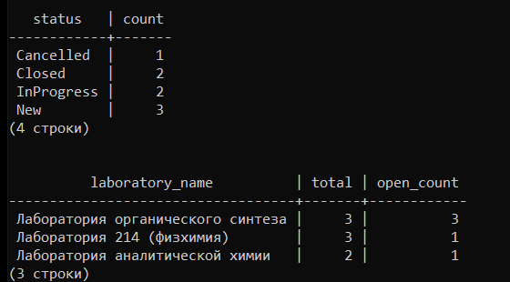

# Лабораторная работа 9. PostgreSQL и SQL

Студент: Салават Исмагилов · Группа: ТРИС-2-23

Тема: Вывоз отходов лаборатории.

## Что сделано

Установлен PostgreSQL 17, создана отдельная учебная база `waste_removal` (не служебная `postgres`). В папке `db` три скрипта:

```text
db/
├── schema.sql   — таблицы, PK, FK, CHECK, индексы
├── seed.sql     — учебные данные
└── queries.sql  — фильтр, сортировка, JOIN, GROUP BY, проверка ограничений
```

C# к базе пока не подключался, это ЛР10. Сервер ЛР8 по-прежнему хранит заявки в памяти.

## Схема

Таблицы и поля взяты из модели данных ЛР2, имена переведены в `snake_case` (`laboratoryId` → `laboratory_id`).

| Таблица | Что хранит | Ключи и ограничения |
|---------|------------|---------------------|
| `laboratories` | справочник лабораторий | PK `id`, `name` UNIQUE |
| `waste_types` | справочник типов отходов | PK `id`, `hazard_class` от 1 до 5 |
| `users` | заведующий, инженеры, эколог | PK `id`, `login` UNIQUE, CHECK на `role` |
| `waste_requests` | заявки на вывоз | PK `id`, `number` UNIQUE, FK на три таблицы, CHECK на статус и длину полей |

Статус ограничен четырьмя значениями, как в API ЛР8:

```sql
status text NOT NULL DEFAULT 'New'
       CHECK (status IN ('New', 'InProgress', 'Closed', 'Cancelled'))
```

`assignee_user_id` допускает `NULL`: у новой заявки исполнителя ещё нет. Название лаборатории и типа отхода в заявке не повторяется, хранятся только `laboratory_id` и `waste_type_id` (3НФ из ЛР2). Длина `title` 5–80 и `description` 10–500 проверяется ещё и в базе, те же правила, что в DTO ЛР8.

`password_hash` в `users` пока пустой, пароли появятся в ЛР11.

### Индексы

| Индекс | Зачем |
|--------|-------|
| `waste_requests_status_idx` | фильтр списка по статусу и подсчёт по статусам |
| `waste_requests_laboratory_id_idx` | JOIN с лабораториями и заявки одной лаборатории |
| `waste_requests_assignee_user_id_idx` | список «мои заявки» для инженера |

### Повторный запуск

В начале `schema.sql` стоят `DROP TABLE IF EXISTS ... CASCADE` только для четырёх наших таблиц. Поэтому схему можно прогонять сколько угодно раз, после неё заново запускается `seed.sql`. Это учебное пересоздание, в API удаления по-прежнему нет.

## Учебные данные

3 лаборатории, 4 типа отходов, 4 пользователя (заведующий, два инженера, эколог) и 8 заявок. Есть все четыре статуса, у заявок `New` исполнитель есть не везде. id в seed заданы вручную, поэтому в конце файла счётчики сдвинуты через `setval`, чтобы следующая вставка не получила занятый id.

## Запуск

```powershell
createdb -U postgres waste_removal
psql -U postgres -d waste_removal -f db/schema.sql
psql -U postgres -d waste_removal -f db/seed.sql
psql -U postgres -d waste_removal -f db/queries.sql
```

В Windows перед этим нужно `$env:PGCLIENTENCODING="UTF8"`, иначе psql читает файлы в кодировке консоли и русские строки ломаются. Пароль базы в репозиторий не кладём.

## Результаты запросов

**1. Фильтр и сортировка** — новые заявки, сначала свежие:

```text
    number    |          title          | status |       created_at
--------------+-------------------------+--------+------------------------
 WR-2026-0008 | Люминесцентные лампы    | New    | 2026-11-22 16:40:00+03
 WR-2026-0007 | Хлороформ и дихлорметан | New    | 2026-11-20 13:05:00+03
 WR-2026-0006 | Вывоз соляной кислоты   | New    | 2026-11-18 08:50:00+03
(3 строки)
```

**2. JOIN** — вместо id видно название лаборатории, тип отхода и ФИО исполнителя. Для исполнителя `LEFT JOIN`, иначе пропали бы заявки без исполнителя:

```text
    number    |               title               |          laboratory_name          |      waste_type_name      |      assignee_name       |   status
--------------+-----------------------------------+-----------------------------------+---------------------------+--------------------------+------------
 WR-2026-0008 | Люминесцентные лампы              | Лаборатория органического синтеза | Ртутные лампы             |                          | New
 WR-2026-0007 | Хлороформ и дихлорметан           | Лаборатория органического синтеза | Органические растворители | Иванов Дмитрий Олегович  | New
 WR-2026-0006 | Вывоз соляной кислоты             | Лаборатория аналитической химии   | Отработанные кислоты      |                          | New
 WR-2026-0004 | Битая посуда из 214               | Лаборатория 214 (физхимия)        | Битая лабораторная посуда | Сабиров Ильнур Ринатович | InProgress
 WR-2026-0003 | Растворители после синтеза        | Лаборатория органического синтеза | Органические растворители | Иванов Дмитрий Олегович  | InProgress
 WR-2026-0002 | Вывоз ртутных ламп                | Лаборатория аналитической химии   | Ртутные лампы             | Сабиров Ильнур Ринатович | Closed
 WR-2026-0005 | Ошибочная заявка на кислоты       | Лаборатория 214 (физхимия)        | Отработанные кислоты      |                          | Cancelled
 WR-2026-0001 | Вывоз отработанной серной кислоты | Лаборатория 214 (физхимия)        | Отработанные кислоты      | Иванов Дмитрий Олегович  | Closed
(8 строк)
```

**3–4. GROUP BY** — заявки по статусам и сводка для заведующего по лабораториям (сколько всего и сколько ещё не закрыто):



**5. Проверка ограничений** — обе ошибочные вставки база отклонила, данные не изменились:

```text
psql:db/queries.sql:41: ОШИБКА:  новая строка в отношении "waste_requests" нарушает ограничение-проверку "waste_requests_status_check"
ПОДРОБНОСТИ:  Ошибочная строка содержит (9, WR-2026-0099, Проверка статуса, Статус Done должен быть отклонён, Done, 1, 1, 1, null, ...).
psql:db/queries.sql:45: ОШИБКА:  INSERT или UPDATE в таблице "waste_requests" нарушает ограничение внешнего ключа "waste_requests_laboratory_id_fkey"
ПОДРОБНОСТИ:  Ключ (laboratory_id)=(999) отсутствует в таблице "laboratories".
```

## Проверка

- [x] `schema.sql` выполнен два раза подряд без ошибок.
- [x] `seed.sql` вставил 3 + 4 + 4 + 8 строк.
- [x] В GROUP BY видны все четыре статуса.
- [x] JOIN показывает названия, а не только id.
- [x] Статус `Done` и несуществующая лаборатория отклонены.
- [x] Сервер PostgreSQL остановлен и запущен заново — в `waste_requests` те же 8 строк.
- [x] В `db` нет дампа, паролей и локальных пользователей.

## Ответы на вопросы

Индекс по статусу нужен, потому что список заявок чаще всего фильтруют по статусу (новые, в работе). Без индекса база просматривает всю таблицу, с индексом сразу находит нужные строки.

Название лаборатории не хранится в заявке, потому что тогда при переименовании пришлось бы менять все заявки этой лаборатории, и легко получить разные написания одного названия. В заявке только `laboratory_id`, название лежит один раз в справочнике.

JOIN соединяет строки разных таблиц (заявка + её лаборатория), количество строк не уменьшается. GROUP BY наоборот сворачивает много строк в одну на группу и считает по ней итог, например количество заявок в каждом статусе.
